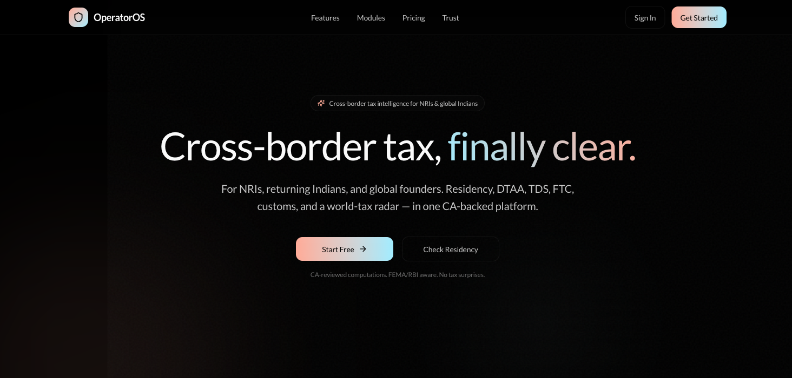
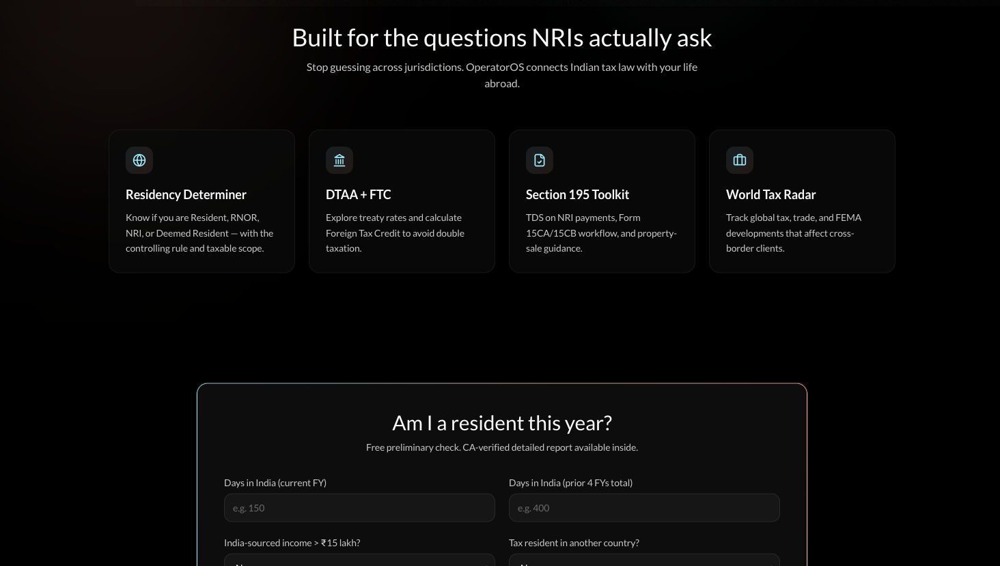
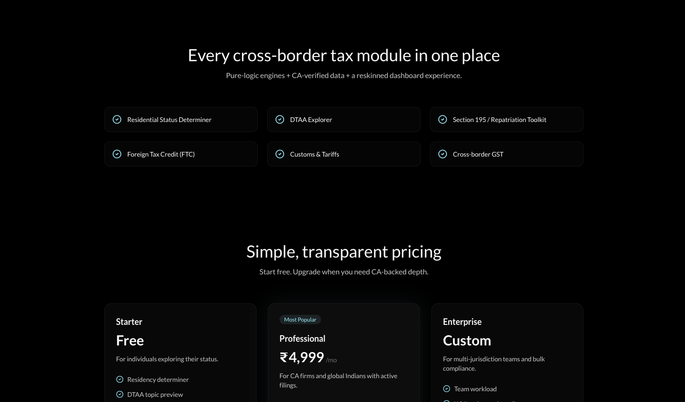
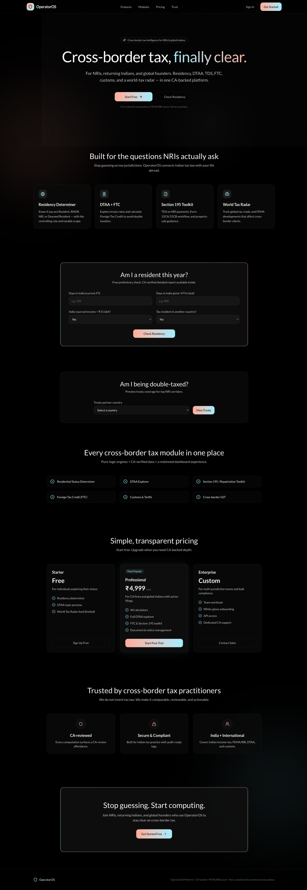
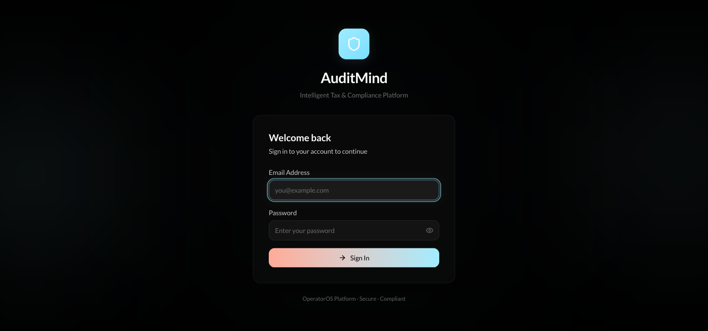

<div align="center">

<br />

# OperatorOS

Cross-border tax workflows for NRIs, returning Indians, and global founders:
residency, DTAA, Section 195, foreign tax credit, customs, and compliance monitoring.

<br />


<br />


<br />



<br />

</div>

---

## Scope

OperatorOS groups calculations and review workflows for residency, treaty relief,
non-resident payments, foreign tax credit, and customs. Its tax radar collects
public developments for review alongside those workflows.

<div align="center">

</div>

---

## The modules

Six cross-border modules sit alongside the Indian tax and compliance modules.

| Module | What it does |
|---|---|
| **Residency Determiner** | Resident / RNOR / NRI / **Deemed Resident** — the controlling rule and your exact taxable scope, AY-keyed (incl. the 1 Apr 2026 change). |
| **DTAA Explorer** | Treaty rates (dividends/interest/royalty/FTS/cap-gains) + tie-breaker + TRC / Form 10F requirements for the top NRI corridors. |
| **Section 195 Toolkit** | TDS on payments to NRIs, the **Form 15CA/15CB** workflow, lower-deduction routes, and property-sale TDS. |
| **Foreign Tax Credit** | Rule 128 / **Form 67** calculator — per-country allowable FTC, DTAA vs non-DTAA. |
| **Customs & Tariffs** | HSN-keyed landed cost — **BCD + SWS + cess + IGST**, with FTA preferential-rate flags. |
| **World Tax Radar** | A feed of global tax and trade developments, including DTAA changes, BEPS/Pillar Two, tariffs, and FEMA, scored for NRI relevance. |

The domestic modules cover **Income Tax** (old/new regime), **TDS**, **GST**, **Capital Gains** with CII indexation, interest 234A/B/C, HRA, depreciation, a retrieval-grounded advisor, document processing, notice drafting, and a compliance calendar.

---

## Verification boundaries

Deterministic calculations have unit tests. Reference data has a review state, and
unverified values can be marked `pending CA review`; the status table below notes
that CA verification of DTAA and customs data is still in progress. Generated or
calculated output is not a substitute for current source documents or professional
tax advice.

---

## Architecture

```
┌─ Frontend ────────────────┐     ┌─ Backend ─────────────────────────────┐
│  React 18 · Vite · TS      │ ──▶ │  FastAPI · SQLAlchemy (async)          │
│  Tailwind v4 · TanStack    │ HTTP│  Pydantic · JWT + RBAC                  │
│  Textura design system     │     │  Tax engine (Decimal, fully tested)    │
└────────────────────────────┘     │  RAG: pgvector + free-llm-router       │
                                    │  Celery workers · Redis · Alembic      │
┌─ World Tax Radar ─────────┐  push └────────────────────────────────────────┘
│  social scraper + model    │ ────▶  /api/tax-intel  ▸  radar panel
└────────────────────────────┘
```

The repository includes backend tests, strict TypeScript checks, and authorization regression tests.

---

## Quickstart

```bash
git clone https://github.com/beepboop2025/operatoros.git
cd operatoros
cp .env.example .env            # set SECRET_KEY (python -c "import secrets;print(secrets.token_hex(32))")

docker compose up               # Postgres+pgvector · Redis · FastAPI · frontend
docker compose exec fastapi alembic upgrade head
docker compose exec fastapi python -m app.seed            # demo firm, users, sample data
```

- App → `http://localhost:5173`  ·  API docs → `http://localhost:8000/docs`

**Frontend only** (to explore the UI without the stack):

```bash
cd frontend && npm install && npm run dev      # → http://localhost:5173
```

---

## Pricing model (in-app)

<div align="center">

</div>

---

## Gallery

<div align="center">

| The landing | Sign in |
|:--:|:--:|
|  |  |

</div>

---

## Status

| Layer | State |
|---|---|
| Tax & cross-border engines, tests, CI | ✅ Complete |
| Textura redesign — landing + full dashboard | ✅ Complete |
| NRI screens + World Tax Radar | ✅ Complete |
| Security hardening (IDOR, token typing) | ✅ Complete |
| CA-verified DTAA / customs data | 📋 In progress — see [`CA_DATA_CHECKLIST.md`](CA_DATA_CHECKLIST.md) |

---

## License

OperatorOS is **source-available** — not open source. You're welcome to read it, study
how it's built, fork it on GitHub, and run it locally. But **commercial use, hosting it as
a service, or building a competing product requires a separate commercial license.** See
[`LICENSE.md`](LICENSE.md).

The repository exposes the calculation engines; reviewed commercial data may be
licensed separately. Open an issue for licensing questions.

---

<div align="center">
<sub>Built with the <strong>Textura</strong> design language · pure-black stage, icy <code>#A1ECFF</code> + peach <code>#FFAB98</code> accents, Gilda Display × Lato.</sub>
<br /><br />
<strong>OperatorOS</strong> — cross-border tax workflows and review tooling.
</div>
